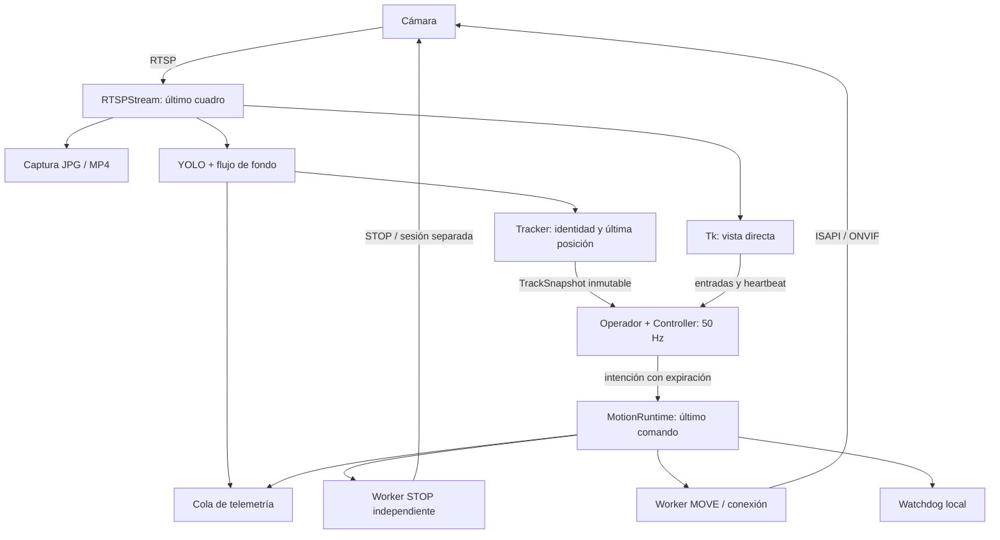

# Arquitectura de Detectcam 2

La propuesta mantiene una aplicación local y un proceso, con componentes
inyectados y mensajes inmutables. La interfaz se conserva como adaptador; el
núcleo nuevo no importa Tk, OpenCV, PyTorch, HTTP ni el proyecto anterior.

## Flujo y propiedad del estado

- Captura es el único escritor del último cuadro. Los consumidores tratan el
  ndarray como sólo lectura; la vista anota una copia.
- Visión es el único propietario de `Tracker`. Cada adquisición se procesa una
  sola vez. Inferencia lenta consume la imagen más reciente al siguiente ciclo.
- El operador es el único propietario de `Controller`. Recibe snapshots y evalúa
  sus edades incluso cuando YOLO no publica nuevos resultados.
- El runtime publica `MotionSnapshot` congelados. Leerlos nunca espera una
  operación de red. Los bloqueos internos abarcan sólo transiciones locales.
- MOVE y STOP tienen trabajadores y conexiones separados. Ningún callback de Tk
  hace red. El watchdog solicita STOP sin tomar un bloqueo de transporte.
- La telemetría tiene colas y consumidores propios; un disco lento o callback
  bloqueado no retiene la parada. Sus muestras pueden descartarse.

## Contratos

`Detection` contiene caja, clase y confianza. `TrackSnapshot` añade identidad,
centro transportado por fondo, velocidades, fase y timestamps de evidencia.
`MotionIntent` contiene velocidad normalizada, cuadro origen y plazo fijo.
`MotionCommand` añade ID único, epoch de cancelación y revisión de ajustes.
`MotionSnapshot` distingue intención, petición en vuelo y confirmación de STOP.

Los eventos permiten seguir `frame_id -> command_id -> dispatched -> completed`.
La aceptación no se cuenta como envío y un ACK no es posición mecánica medida.

## Pérdida breve y recuperación

El destino es el último punto observado, transportado por movimiento de fondo
fiable. No se repite indefinidamente el último vector de velocidad del dron.
Sin estimación fiable, el controlador limita la integral de orden por eje y el
tiempo desde la última detección. Una detección válida nueva cancela esa búsqueda.
Al cambiar confianza/clases se invalida la revisión anterior y se reinicia el
tracker; una inferencia que termine tarde no puede reactivar el filtro viejo.

`captured_at` se conserva desde la adquisición local. `predict(now)` no lo
actualiza. La intención vence por el mínimo entre TTL, antigüedad de cuadro y
plazo de recuperación. El heartbeat mantiene presencia, sin prolongar evidencia.

## Orden de parada y fallos

Una parada incrementa un epoch, elimina movimiento pendiente y despierta STOP.
Un MOVE que ya está cruzando la red puede llegar después del primer STOP; al
volver su petición se solicita otro STOP. Los plazos de socket no son un límite
absoluto del firmware y no pueden garantizar detención durante una caída de red.

Un error de transporte deja el sistema desarmado. Reconectar es una acción
explícita que reinicia transporte y exige respuesta de STOP antes de habilitar
armado; nunca repite un movimiento fallido ni cambia de protocolo para repetirlo.
ISAPI -> ONVIF sólo se intenta durante la conexión inicial.

## Configuración y recursos compartidos

`config.settings` valida una vez y la composición inyecta ajustes. Las únicas
excepciones heredadas son opciones de FFmpeg requeridas por OpenCV y la lectura
dinámica de secretos en el filtro de logs. Los adaptadores se construyen con
argumentos explícitos y no importan módulos de `ptz_test`.

`.venv` y `model` son enlaces a los recursos originales. El `.env` compartido se
lee, no se modifica ni se copia. La precedencia es entorno de proceso, `.env`
local y `.env` compartido. Los nuevos perfiles/ganancias viven en TOML.

## Elección de lenguajes

Se conserva Python para el estado y la interfaz, donde importa reproducibilidad
y uso del entorno existente. OpenCV ejecuta decodificación/visión en C++ y
PyTorch usa sus kernels nativos CPU/CUDA. El núcleo de seguimiento usa sólo
stdlib y dataclasses con slots; su coste medido con datos sintéticos es pequeño
frente a la inferencia del modelo existente.

No hay una extensión C++ nueva ni un proceso extra que copie cada frame entre
intérpretes. Cambiar aritmética a otro lenguaje no reduce codificación, red ni
latencia mecánica. Si una medición futura identifica una sección Python dominante,
las interfaces de mensajes permiten sustituir esa implementación sin rehacer Tk.

La propuesta no cambia el modelo ni exporta pesos automáticamente. Una evaluación
ONNX/TensorRT debe usar el hardware disponible y secuencias de drones para medir
velocidad y precisión; no se promete ganancia con una exportación no probada.
